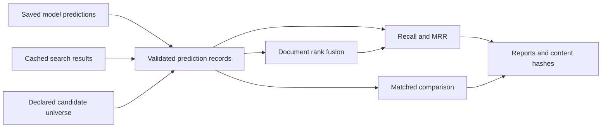

# Generative Retrieval Lab

A portable evaluation and ranking toolkit for experiments that retrieve document
identifiers with a language model and combine them with conventional search.

The focus is the engineering around a credible experiment: explicit candidate
universes, held-out queries, reproducible artifacts, matched comparisons and
document-level fusion. The public package runs entirely offline on a CPU with
**Python 3.11+ and no runtime dependencies**.

## Quick start

```bash
python -m venv .venv
# Linux/macOS: source .venv/bin/activate
# Windows PowerShell: .venv\Scripts\Activate.ps1
python -m pip install .

genrag doctor
genrag score examples/synthetic/dense.jsonl --universe examples/synthetic/universe.json
genrag compare examples/synthetic/dense.jsonl examples/synthetic/generative.jsonl --universe examples/synthetic/universe.json
```

The invented five-question example scores dense Recall@10 at 0.6 and generative
Recall@10 at 0.8. These numbers demonstrate the API; **they are not research
results or evidence that one retrieval method is generally better**.

## What is implemented

| Capability | Behavior |
|---|---|
| Prediction adapters | Read model candidate lists or cached component document results |
| Identifier constraints | Tokenizer-independent trie for registered-ID decoding |
| Retrieval metrics | Recall@1/5/10 and properly truncated MRR; misses remain in the denominator |
| Matched comparisons | Reject different query sets, target IDs or retrieval depths |
| Candidate-universe checks | Require the declared eligible document set and fingerprint it |
| Document aggregation | Keep each document's highest-scoring chunk, with deterministic ties |
| Weighted RRF | Fuse document rankings without counting duplicate channel votes |
| Artifact integrity | SHA-256 manifests with relative paths and traversal protection |
| Publication tooling | Allowlisted export, secret-pattern checks and configurable confidential terms |

Unknown candidate positions and duplicate predictions are retained during scoring,
so input cleanup cannot silently improve a model's measured rank. A depth-five
capture cannot accidentally become a Recall@10 result. The library does not
infer embedding compatibility from vector dimensions alone.

## Architecture



```python
from genrag import Prediction, Universe, compare

universe = Universe(frozenset({"DOC-A", "DOC-B"}))
dense = [Prediction("Q-1", "DOC-A", ("DOC-B", "DOC-A"))]
generative = [Prediction("Q-1", "DOC-A", ("DOC-A", "DOC-B"))]
report = compare(dense, generative, universe)
print(report["right"]["mrr_at_10"])  # 1.0
```

## Scope and research lessons

This package is the portable evaluation layer extracted from a larger generative
retrieval research workspace. Historical training/generation runners, operational
records, private corpora and checkpoints are not part of the public export.
Bring saved predictions from your own training, inference or search backend.
No command downloads a model, contacts an API, inspects credentials or starts GPU
work. Embedding validation exposes an injection protocol for backend integration.

The design reflects several recurring experimental pitfalls:

- A model choosing among a small memorized subset cannot be compared fairly with
  search over a much larger corpus.
- Adding BM25 to dense search does not guarantee an improvement; fusion and
  candidate depth need controlled evaluation.
- Choosing a preferred document section instead of its highest-scoring chunk can
  demote relevant documents when additional chunks become available.
- Complementary hits show potential headroom. Their oracle union is not an
  achieved top-k fusion score.
- Reused synthetic development questions are useful for iteration, but they are
  not a fresh real-user test or a production claim.

## Documentation

- [Getting started](docs/getting-started.md): installation, CLI and input formats.
- [Architecture](docs/architecture.md): boundaries and reusable Python interfaces.
- [Research design](docs/research-design.md): query-to-ID training, constrained decoding and controlled experiments.
- [Dataset reproducibility](docs/dataset-reproducibility.md): source snapshot, registry, question roles, QA, release history and reference checksums.
- [Evaluation methodology](docs/evaluation.md): contracts, metrics and limitations.
- [Development](docs/development.md): tests, formatting, builds and legacy compatibility.
- [Publishing](docs/publishing.md): public-safe export and GitHub preparation.
- [Synthetic example](examples/synthetic/README.md): analytically checkable inputs.

For development:

```bash
python -m pip install ".[dev]"
python -m unittest discover -s tests/public -v
ruff check src tests/public
ruff format --check src tests/public
python -m build
```

CI runs portable tests on Linux and Windows with Python 3.11–3.13 and builds
distribution artifacts. It has no provider secrets, dataset mounts or GPU jobs.
The code-only export is [MIT licensed](LICENSE). [NOTICE.md](NOTICE.md) explains
its scope. Data-free prompt/schema specifications are included; model weights,
research questions and source documents are not redistributed or relicensed.
