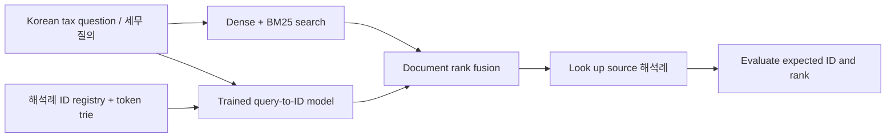

# Korean Law Generative Retrieval

[](https://github.com/sungmin-kwon/law-generative-retrieval/actions/workflows/ci.yml)

**Find the Korean tax ruling (해석례) that answers a user's question.** This
project explores training a language model to retrieve a ruling's identifier,
then combining its candidates with dense-vector and BM25 search.

For example, a user might ask:

> 변질된 물건을 거래처에서 반품받아 동일한 제품으로 바꿔 주면 수정세금계산서도 발급해야 하나요?

The retrieval task is to return a relevant ruling such as
[**부가46015-1636 (1995-09-07)**](https://taxlaw.nts.go.kr/qt/USEQTA002P.do?ntstDcmId=010000000000088650),
which addresses tax invoices for returned spoiled goods and replacement products,
with its stable evidence ID. The model predicts an ID; the application
looks up the source document. It does not need to invent a legal answer.

The public Python package includes the reusable decoding constraints, evaluation
and fusion code. A runnable four-ruling sample below shows the workflow without
API credentials, a database or a GPU. **The rulings are real, published NTS
interpretations. The example questions and candidate rankings are authored for
the walkthrough; they are not measured model predictions.**

## Run the Korean example

From the repository root, using Python 3.11+:

```bash
python -m venv .venv
# Linux/macOS: source .venv/bin/activate
# Windows PowerShell: .venv\Scripts\Activate.ps1
python -m pip install .

genrag demo-ko
# Machine-readable version:
genrag demo-ko --json
```

The demo loads four actual 해석례, with official references and source links:

| Official document number | Issued | Topic / official title |
|---|---|---|
| [부가46015-1636](https://taxlaw.nts.go.kr/qt/USEQTA002P.do?ntstDcmId=010000000000088650) | 1995-09-07 | 거래처로부터 변질된 물품을 반품 받고 교환하여 주는 제품에 대한 세금계산서 |
| [법규국조 2009-375](https://taxlaw.nts.go.kr/qt/USEQTA002P.do?ntstDcmId=010000000000138098) | 2009-11-16 | 본점에 대한 미지급금 계정을 본점계정으로 대체시 채무면제이익 해당 여부 |
| [서면인터넷방문상담1팀-1308](https://taxlaw.nts.go.kr/qt/USEQTA002P.do?ntstDcmId=010000000000025811) | 2005-10-28 | 부동산임대업자의 차량유지비 등 필요경비 산입 여부 |
| [부가22601-303](https://taxlaw.nts.go.kr/qt/USEQTA002P.do?ntstDcmId=010000000000009664) | 1992-03-10 | 당초의 거래상대방이 아닌 자로부터 반품을 받는 경우 수정세금계산서 |

For the Korean question above, it displays the sample dense, BM25 and generative
candidate lists, runs the package's actual reciprocal-rank fusion, validates
identifiers against the four-document registry/trie, and resolves the selected
document with its official number, date and URL. The two VAT rulings concern
different facts: replacing spoiled goods versus a return from someone other
than the original counterparty. Similar keywords need not identify the same ruling.

| Stage in this worked example | Expected ruling's rank |
|---|---:|
| Sample dense candidates | 2 |
| Sample BM25 candidates | 2 |
| Dense + BM25 fusion | 3 |
| Sample generative candidates | 1 |
| Dense + BM25 + GR fusion | 1 |

These hand-authored rankings illustrate how fusion changes the ordering. They
do not establish that GR improves a real search system. The demo performs real
ID validation, fusion and document lookup; embedding/model inference is not run.
Its trie uses character-code tokens for teaching; a model integration uses that
model's tokenizer instead.

Inspect the [official sample and question pairs](src/genrag/data/korean_tax_rulings.json)
or follow the [worked-example walkthrough](examples/korean-tax/README.md).
The example also runs from an installed wheel outside the repository directory.
The sample contains official metadata and short attributed excerpts alongside
project-authored summaries. These are historical documents, not an assertion
of current tax treatment. [Sources and attribution](examples/korean-tax/SOURCES.md)
explain selection, verification and the distinction from the code's MIT license.

## What is learned during training?

Different Korean questions are paired with the same ruling ID. One illustrative
question paired with the real ruling is:

```json
{
  "query": "고객이 변질된 상품을 돌려보내 같은 제품으로 교환해 주면 세금계산서를 다시 처리해야 하나요?",
  "evidence_id": "NTS-INTERP-VALUEADDTAX-0063027"
}
```

The sample includes four wording roles for this ruling: plain language, keyword
search, a fact pattern and a statute-oriented question. Its example evaluation
question uses different wording for the same target document. These records are
illustrations authored for the public example; they were not imported from the
research training or evaluation questions. The `NTS-INTERP-…` IDs are the project's
registered retrieval targets; the official document numbers and NTS source IDs
remain available separately for attribution and lookup.

In the reference research workflow, Qwen3.6-27B LoRA training learned question-to-ID
mappings over Korean tax interpretations. An identifier trie restricts generation
to registered ruling IDs. The returned IDs can be evaluated alone or fused with
the existing dense/BM25 rankings before evidence is passed downstream.



This diagram describes the research system. The public demo substitutes saved
illustrative rankings for the model/search backends; private generation/training
orchestration, credentials, checkpoints and full research datasets are not bundled.

## Korean dataset and reproducibility

The reference dataset was consolidated from an existing chunked snapshot of
National Tax Service 해석례 originating from the
[국세법령정보시스템](https://taxlaw.nts.go.kr/):

| Reference artifact | Scope |
|---|---|
| Frozen corpus / candidate universe | 135,991 rulings, 434,740 chunks |
| Final training release | 1,622,929 question–ID pairs over 135,989 rulings |
| Question expansion | Four roles → eight → up to twelve per ruling |
| Synthetic development sets | 4,992 questions and an older 988-question reference |

The [dataset reproducibility guide](docs/dataset-reproducibility.md) explains
snapshot export, source identity, tax-category mapping, grounded question
generation, deduplication/reversal, QA, held-out questions and exact-reproduction
limits. [Data-free prompts, schemas and provenance](dataset_specs/README.md) are
included. Apart from the four attributed ruling examples, the full corpus,
training/evaluation releases and weights are not distributed or relicensed;
exact historical reproduction requires access to
the frozen inputs and generation records.

## Reusable package

The core remains portable and offline, with **no runtime dependencies**:

| Capability | Behavior |
|---|---|
| Identifier constraints | Tokenizer-independent trie for registered-ID decoding |
| Saved prediction adapters | Model candidate lists or cached search-component results |
| Retrieval metrics | Recall@1/5/10 and truncated MRR; misses stay in the denominator |
| Matched comparisons | Reject different query sets, expected IDs or retrieval depths |
| Candidate universes | Explicit eligible-document sets and content fingerprints |
| Chunk aggregation | Highest-scoring chunk per document, with deterministic ties |
| Weighted RRF | Document-level fusion without duplicate channel votes |
| Integrity and export | Relative-path artifact manifests and screened source exports |

For an analytically checkable five-question scoring example:

```bash
genrag score examples/synthetic/dense.jsonl --universe examples/synthetic/universe.json
genrag compare examples/synthetic/dense.jsonl examples/synthetic/generative.jsonl --universe examples/synthetic/universe.json
```

That separate fixture tests metric behavior; it is not the Korean corpus demo
or a published retrieval benchmark. Neither example measures real-user quality.

## Documentation and development

- [Korean worked example](examples/korean-tax/README.md)
- [Getting started and file formats](docs/getting-started.md)
- [Architecture](docs/architecture.md) and [research design](docs/research-design.md)
- [Dataset reproducibility](docs/dataset-reproducibility.md)
- [Evaluation methodology](docs/evaluation.md)
- [Development](docs/development.md) and [publishing](docs/publishing.md)

```bash
python -m pip install ".[dev]"
python -m unittest discover -s tests/public -v
ruff check src tests/public
ruff format --check src tests/public
python -m build
```

CI checks Linux/Windows with Python 3.11–3.13, including the Korean demo. Tests
require no paid API, private database or GPU. They use synthetic fixtures and the
packaged official sample. The code, documentation and project-authored examples
are [MIT licensed](LICENSE); [NOTICE](NOTICE.md) identifies attributed official
material and the boundary with undistributed research data.
