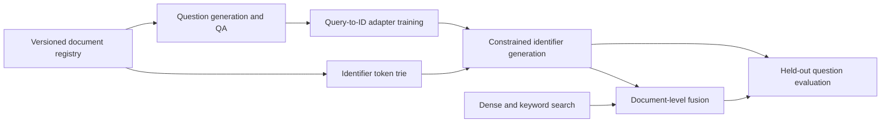

# Generative retrieval research design

## From question to stable document identifier

A conventional retriever scores a question against document representations.
A generative retriever instead predicts a document identifier token by token.
The training pair is a question and a stable target ID, not a generated legal
answer or a document summary. Retrieved source documents remain the evidence
used by a downstream application.



Keep the source UID immutable and version the target-ID mapping separately.
Snapshot the registry and bind it into data, training and evaluation contracts.
An identifier change otherwise changes the learning target even when the source
document is unchanged.

## Constrained decoding

`IdentifierTrie` stores tokenizer-produced sequences for eligible document IDs.
At each output step, its `allowed_next` method returns only continuations that
can reach a registered identifier. EOS is permitted only at terminal nodes.
An invalid prefix returns no allowed tokens; it never silently enables arbitrary
text. This guarantees syntactic membership under a correctly integrated decoder,
not that the selected identifier is relevant to the question.

```python
from genrag import IdentifierTrie

trie = IdentifierTrie(eos_token_id=99)
trie.add([10, 20, 30])  # IDs tokenized by the caller's model tokenizer
trie.add([10, 20, 40])
assert trie.allowed_next([10, 20]) == (30, 40)
assert trie.allowed_next([10, 20, 30]) == (99,)
```

The public package does not load a tokenizer/model or run generation. An external
generation adapter must remove prompt/padding tokens from the decoder prefix,
use the correct EOS token, handle an empty allowed set as a failed generation,
and verify the decoded ID against the same registry. Check for ambiguous ID
tokenizations before creating the trie.

## Controlled training comparisons

When adding question roles, distinguish new information from additional optimizer
updates. Start treatment and control from identical adapter/optimizer/RNG state,
match example and update budgets, and replace repeated-question slots with newly
generated questions only in treatment. Retain corpus-wide rehearsal when a small
subset receives additional questions so specialization is not mistaken for a
general improvement.

Record cumulative passes separately from examples seen. Twenty passes over four
questions and one pass over twelve are not twenty-one equivalent training budgets.
Warm starts also preserve earlier exposure imbalance; they need not be invalid,
but a fresh-adapter comparison is a separate experiment with a separate cost.

## Reproducibility boundaries

Freeze source/prompt/schema/model-route identities, raw generation ledgers, QA
decisions, dataset hashes, training recipe and checkpoint state. Preserve failures
and recovery provenance rather than replacing them with a cleaner-looking history.
Use exact-collision policies explicitly; near-duplicate removal can discard useful
wording and should not be conflated with preventing evaluation leakage.

This public tree supplies reusable decoding constraints, metric/ranking logic and
synthetic demonstrations. Private generation, training orchestration, original
questions and checkpoint artifacts remain outside it. The methodology describes
the surrounding research design; it is not a claim that the package trains a
model or reproduces undistributed experiments on its own.
